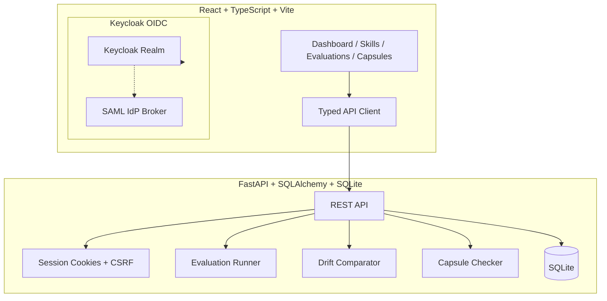

# Beacon Pilot | Ryan Vo | AI & Machine Learning

> Work in progress. This checkpoint may be incomplete or fail tests. See PLAN.md and STATUS.md before use.


**Production-grade skill evaluation and drift detection for AI coding agents.**

Beacon Pilot is a developer tool for evaluating AI coding agent skills with deterministic, reproducible scoring. It implements a rigorous evaluation methodology inspired by [Driftproof](https://driftproofhq.com) — using confidence-band comparisons and effect floors to detect genuine model regressions across releases, not noise.

## The Problem

AI coding agents are evaluated inconsistently:
- **No standardized skill definitions** — each team defines "code review skill" differently
- **Non-deterministic evaluation** — LLM-as-judge introduces variance that masks real regressions
- **No drift detection** — model updates (Sonnet 4.6 → 5) silently degrade agent performance
- **Knowledge loss** — agents rediscover the same repository patterns every session

## The Approach

Beacon Pilot provides three integrated workflows:

### 1. Skill Evaluation Engine (Deterministic Core)
- Define skills with JSON schemas — criteria, thresholds, test cases
- Run evaluations **without any LLM calls** — deterministic pseudorandom scoring with configurable variance
- **Confidence bands** from 5× sampling (matching Driftproof methodology)
- **Effect floor (0.05)** — regressions only flagged when bands separate AND mean shift exceeds threshold

### 2. Model Drift Detection
- Store historical evaluation results per skill/model/version
- Compare new model versions against baseline using band separation + effect floor
- Verdict: `regression` | `improvement` | `within_noise`
- Reproducible CLI command for CI integration

### 3. Repository Memory Capsules
- `AGENT_MEMORY.md` files colocated with subsystems (per [issue #398](https://github.com/addyosmani/agent-skills/issues/398))
- Structured frontmatter: `scope`, `evidence`, `invalidated_by`, `claims`
- **Git-aware freshness checker** (`check-memory.sh` equivalent) — compares against trusted base ref
- Only `verified` capsules (byte-identical to trusted ref, no invalidation paths changed) are retrievable
- Conservative: squash/rebase/nonlinear history → `unknown`, never stale content

## Architecture



## Quick Start

### Prerequisites
- Docker & Docker Compose
- Node 24, Python 3.12 (for local development)

### With Docker Compose (Recommended)

```bash
# Clone and start
git clone https://github.com/A220man/beacon-pilot-144-ryan-vo.git
cd beacon-pilot-144-ryan-vo

# Copy env and configure
cp .env.example .env
# Edit .env if needed (defaults work for local demo)

# Start all services
docker compose up -d

# Services:
# - Frontend: http://127.0.0.1:5173
# - Backend API: http://127.0.0.1:8000
# - Keycloak: http://127.0.0.1:8080 (admin/admin)
```

### Local Development

```bash
# Backend
cd backend
python3 -m venv .venv
source .venv/bin/activate
pip install -r requirements.txt
cp ../.env.example .env
uvicorn app.main:app --reload --host 127.0.0.1 --port 8000

# Frontend (separate terminal)
cd frontend
npm install
npm run dev

# Keycloak (optional - backend has demo binder)
docker run -p 8080:8080 -e KC_BOOTSTRAP_ADMIN_USER=admin -e KC_BOOTSTRAP_ADMIN_PASSWORD=admin quay.io/keycloak/keycloak:26.0 start-dev
```

### Demo Credentials
| User | Password | Role |
|------|----------|------|
| `demo` | `demo` | Viewer (read-only) |
| `operator` | `operator` | Operator (create skills/evals) |

## API Reference

### Authentication
- `GET /auth/login` — Initiate OIDC login (returns auth_url, state, nonce)
- `GET /auth/callback` — OIDC callback (handled by frontend)
- `POST /auth/logout` — Clear session cookie
- `GET /auth/me` — Current user info

### Skills
- `POST /api/skills` — Create skill (operator+)
- `GET /api/skills` — List skills (paginated, searchable)
- `GET /api/skills/{id}` — Get skill
- `PATCH /api/skills/{id}` — Update skill (operator+)
- `DELETE /api/skills/{id}` — Delete skill (admin)

### Evaluations
- `POST /api/evaluations` — Create evaluation (operator+)
- `GET /api/evaluations` — List evaluations (filterable)
- `GET /api/evaluations/{id}` — Get evaluation
- `POST /api/evaluations/{id}/run` — Run deterministic evaluation

### Capsules
- `POST /api/capsules` — Create capsule (operator+)
- `GET /api/capsules` — List capsules
- `GET /api/capsules/{id}` — Get capsule
- `PATCH /api/capsules/{id}` — Update capsule
- `DELETE /api/capsules/{id}` — Delete capsule (admin)
- `POST /api/capsules/{id}/check` — Check freshness (Git-aware)

## Configuration

| Variable | Description | Default |
|----------|-------------|---------|
| `APP_ENV` | `development` or `production` | `development` |
| `DATABASE_URL` | SQLite async URL | `sqlite+aiosqlite:///./data/beacon.db` |
| `KEYCLOAK_URL` | Keycloak base URL (empty = demo mode) | `http://127.0.0.1:8080` |
| `KEYCLOAK_REALM` | Realm name | `beacon` |
| `KEYCLOAK_CLIENT_ID` | Client ID | `beacon-pilot` |
| `KEYCLOAK_CLIENT_SECRET` | Client secret (required in prod) | `` |
| `SESSION_SECRET` | Session cookie signing key | `dev-secret-change-in-production` |
| `LLM_API_KEY` | LLM provider key (optional) | `` |
| `LLM_PROVIDER` | `openai-compatible`, `anthropic`, `gemini`, `ollama` | `openai-compatible` |
| `TRUSTED_BASE_REF` | Git ref for capsule freshness | `origin/main` |

## Security

- **Authentication**: OIDC authorization code + PKCE via Keycloak
- **Session**: HttpOnly SameSite=Lax cookies, CSRF-protected writes
- **Roles**: `viewer` (read), `operator` (write), `admin` (delete)
- **LLM Keys**: Server-side only, never exposed to frontend
- **Demo Mode**: Binds to 127.0.0.1, refuses startup if `APP_ENV=production` without Keycloak
- **No secrets in repo**: `.env.example` has blanks only

### Production Deployment Notes
- Set `APP_ENV=production`, `SESSION_COOKIE_SECURE=true`
- Provide real `KEYCLOAK_CLIENT_SECRET` and `SESSION_SECRET`
- Configure TLS reverse proxy (nginx/Caddy) — app binds to 127.0.0.1 only
- Use external PostgreSQL for HA (migrate `DATABASE_URL`)
- Enable Keycloak SAML broker for enterprise IdPs
- Backup: SQLite file + Keycloak realm export

## AI/ML Evaluation

Beacon Pilot's evaluation engine is itself the AI/ML component — a **deterministic offline core** that produces reproducible scores without LLM calls.

### Reproducible Evaluation Command
```bash
# Backend: run evaluation via API
curl -X POST http://127.0.0.1:8000/api/evaluations/1/run \
  -H "Content-Type: application/json" \
  -b "beacon_session=<cookie>"

# Or use the deterministic runner directly
python -c "
from app.services.evaluation_runner import run_deterministic_evaluation
from app.models import Evaluation
import asyncio, json

async def main():
    eval = Evaluation(skill_id=1, model_name='test', model_version='1.0', input_data='{\"n_runs\": 5}')
    result = await run_deterministic_evaluation(eval, None)
    print(json.dumps(json.loads(result['result_json']), indent=2))

asyncio.run(main())
"
```

### Baseline & Methodology
- **5× sampling** per evaluation (configurable via `input_data.n_runs`)
- **Confidence bands**: 2.5th–97.5th percentiles of sampled scores
- **Effect floor**: 0.05 mean difference required for regression/improvement
- **Verdict**: `regression` (bands separate + diff < -0.05), `improvement` (bands separate + diff > 0.05), `within_noise` (otherwise)

### Failure Cases
- Non-deterministic upstream LLM calls (not used in core)
- Insufficient runs (< 3) → wide bands, low power
- Missing historical baseline → no drift comparison possible
- Git history unavailable → capsule freshness returns `unknown`

## Project Structure

```
beacon-pilot/
├── backend/
│   ├── app/
│   │   ├── api/          # REST endpoints
│   │   ├── core/         # Config, DB, Auth
│   │   ├── models/       # SQLAlchemy models
│   │   ├── services/     # Evaluation runner, Capsule checker
│   │   └── main.py       # FastAPI app factory
│   ├── tests/            # Pytest tests (12+)
│   ├── requirements.txt
│   └── Dockerfile
├── frontend/
│   ├── src/
│   │   ├── components/   # Reusable UI
│   │   ├── pages/        # Route pages
│   │   ├── hooks/        # React Query hooks
│   │   ├── api/          # Typed API client
│   │   └── types/        # TypeScript types
│   ├── tests/            # Vitest tests (3+)
│   ├── package.json
│   └── Dockerfile
├── keycloak/
│   └── realm-export.json
├── compose.yaml
├── .github/workflows/ci.yml
├── portfolio.json
├── pyproject.toml
└── README.md
```

## Development

```bash
# Backend tests
cd backend && .venv/bin/python -m pytest tests/ -v

# Frontend typecheck + build
cd frontend && npm run build

# Frontend tests
cd frontend && npm test

# Lint
cd frontend && npm run lint
```

## License

MIT License — Copyright (c) 2026 Ryan Vo <ryandtvo@gmail.com>